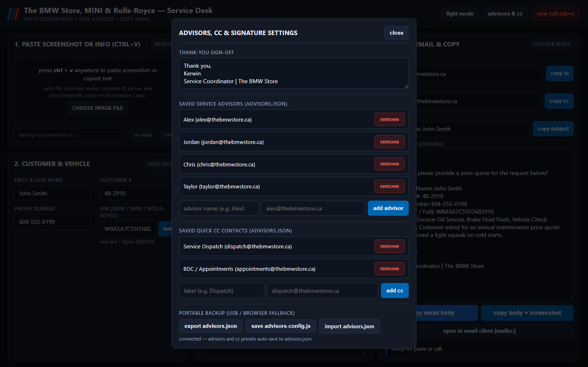

# workslacker

i built this tool to speed up my daily workflow at the bmw, mini & rolls-royce service desk (all three brands share the same service advisors). instead of re-typing customer info into email templates while taking calls and jumping between tekion and awp, i launch one app off my usb drive, paste a screenshot or customer info, type the problem, and copy the email straight into outlook.

## screenshots

### service desk dashboard

### advisors, cc & portable usb sync

## how it works

1. **clipboard ocr & text parser (`app.js`):** hitting `ctrl + v` with an image boosts screenshot contrast on a hidden canvas, runs tesseract.js ocr, and passes the extracted text through `parseTekionOrAwpText` (or parses raw pasted text directly). it cleans common vin ocr mistakes (`O`/`Q` -> `0`, `I` -> `1`), normalizes phone formats to `XXX-XXX-XXXX`, and splits variable-length customer numbers (including brackets, hyphens, or `#`) from customer names while ignoring model years and street lines.
2. **awp & advisor formatting:** calculates `awp last 7 digits` live from any full 17-character bmw (`WBA...`), mini (`WMW...`, `WMZ...`), or rolls-royce (`SCA...`) vin and rebuilds `To`, `CC`, `Subject`, and the editable email body on every input or chip toggle.
3. **portable usb storage (`workslacker.bat` & `advisors-config.js`):** running `workslacker.bat` launches a hidden powershell tcp server on `127.0.0.1` paired with edge/chrome `--app` mode so edits to advisors, cc presets, or the signature auto-save straight back to `advisors.json` and `advisors-config.js` on the usb drive.

## one-click usb launch
1. copy this folder onto a usb drive.
2. double-click **`workslacker.bat`**.

it launches a clean standalone app window (edge/chrome `--app` mode) backed by a zero-admin local server in powershell so all advisor and cc presets save straight back to **`advisors.json`** and **`advisors-config.js`** on the usb across any work pc.

## backup plans if the work pc blocks the launcher
if work IT restricts `.bat` files, powershell, or usb execution, there are four ways to run it without admin rights:

1. **primary — `workslacker.bat`:** double-click `workslacker.bat` off the usb for auto-syncing `advisors.json` + `advisors-config.js`.
2. **direct `file://` — double-click `index.html`:** opens straight in the browser with no server needed. `advisors-config.js` pre-loads all your saved advisors and cc presets without CORS issues. if you add an advisor here, use **`save advisors-config.js`** in **settings** to update `advisors-config.js` on the usb.
3. **browser app install (no `.bat`):** open `index.html` (or the hosted page) in edge/chrome, open the browser menu (`...`), and pick **apps -> install this site as an app** to pin the same standalone app window on that pc.
4. **hosted fallback — github pages + import:** open `https://kerwinmok.github.io/workslacker/` in any browser and use **import json** in settings to load `advisors.json` off your usb (settings also stay cached in that browser's localStorage).

## quick workflow
1. **paste (`ctrl + v`):** take a snip (`win + shift + s`) of the customer profile in tekion/awp or copy text and hit `ctrl + v` anywhere on the app. ocr and text parsing automatically extract:
   - **customer name & variable-length customer #** (shorter or longer ids like 3–10 digits, hyphens/dashes like `48-2910`, brackets `(4829)` / `[482910]`, or `#9821`)
   - **phone number** in any format (`6045550199`, `+1 [604] 555-0199`, `604.555.0199`, dashes/spaces) normalized to `604-555-0199`
   - **bmw, mini & rolls-royce vins** (`WBA...`, `WMW...`, `WMZ...`, `SCA...`, etc., plus 7-char awp short vins) with automatic ocr lookalike cleanup (`O`/`Q` -> `0`, `I` -> `1`)
2. **pick advisor, cc & problem:** the first advisor starts selected automatically (shared across bmw, mini, and rolls-royce), or i click a different advisor pill, add any cc contacts, click quick bmw/mini/rolls-royce service chips, and type the problem notes.
3. **copy into outlook:** `To`, `CC`, `Subject`, and the tailored `Email Body` update live with one-click copy buttons (`copy to`, `copy cc`, `copy subject`, `copy email body`, `copy body + screenshot`).

## repo files
- `workslacker.bat` — single-click portable usb launcher + local config server
- `advisors.json` — saved service advisors, quick cc contacts, and signature
- `advisors-config.js` — `file://` backup preset script kept in sync alongside `advisors.json`
- `index.html`, `style.css`, `app.js` — dashboard ui, auto-ocr contrast boost, and email builder
